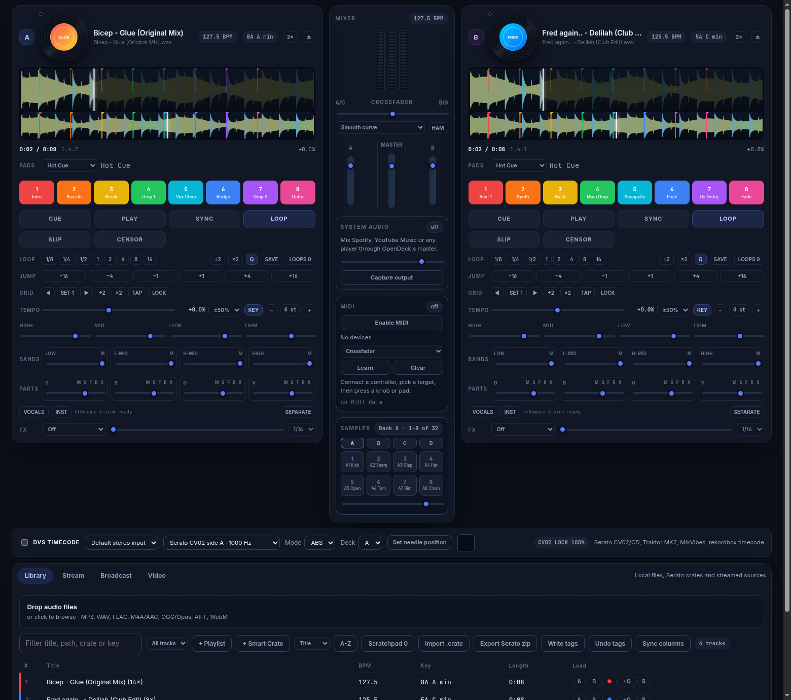
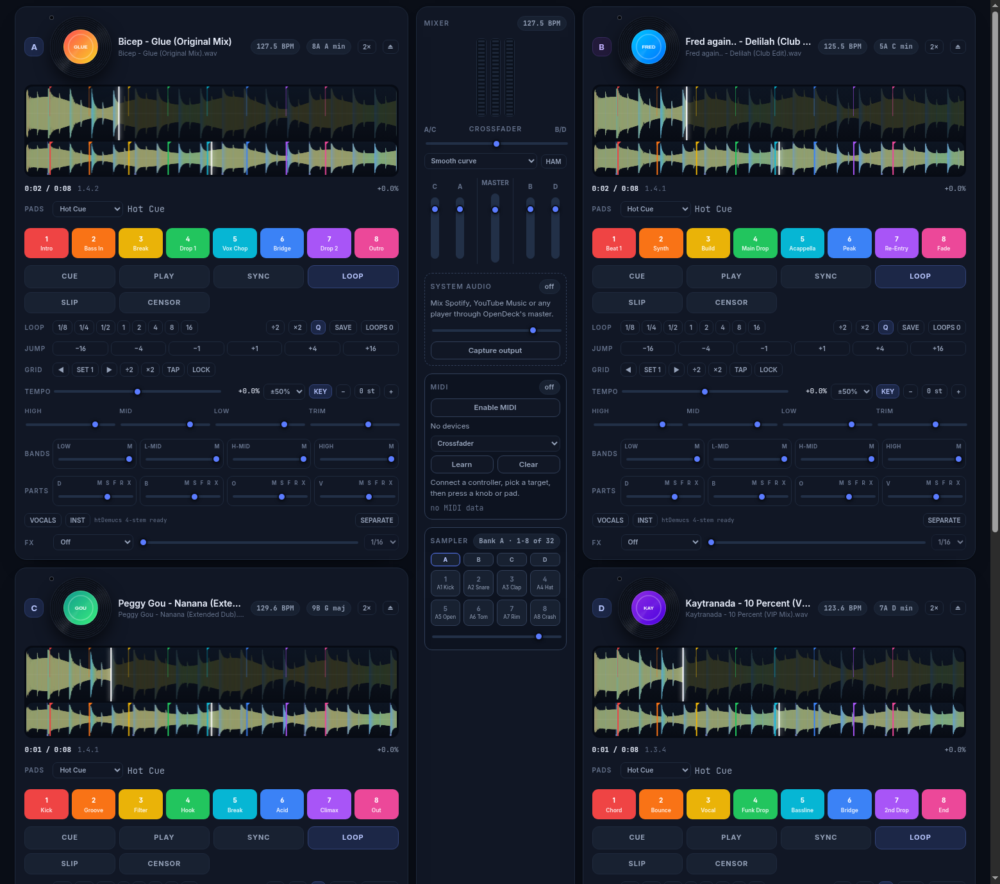
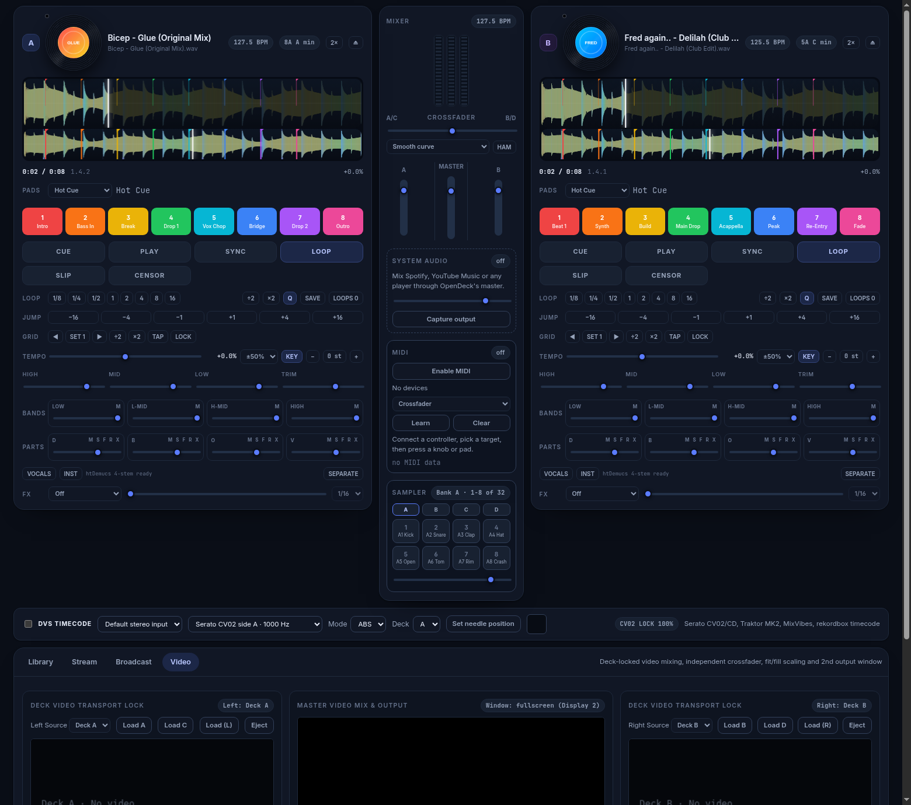
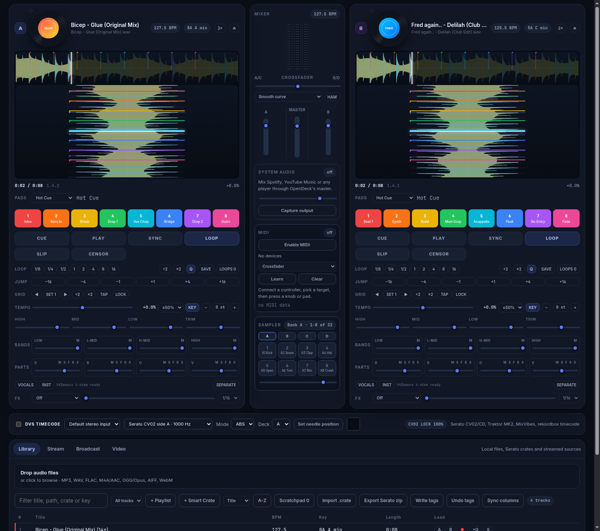

# OpenDeck (Desktop)

Open-source 4-deck DJ application with sample-accurate PCM transport, real DVS timecode control, 4-part htDemucs stem separation, 10 performance pad modes, a 32-slot sampler, 15 built-in FX with savable custom chains, a 195-device MIDI/HID/DVS hardware catalogue, zero-loss Serato library interoperability, and Phase 7 deck-locked Video Mixing. Built with a TypeScript UI running inside an Electron shell or a native Rust/Tauri shell (`OpenDeck.exe` / `bin/opendeck-app.exe`), MIT licensed, with zero telemetry.

---

## Screenshots

### 2-Deck Performance, DVS Timecode & Library / Smart Crates


### 4-Deck Performance Mode (Decks A, B, C & D + 4-Channel Mixer)


### Phase 7 Video Mixing (Deck-Locked Transport, Video Crossfader & 2nd Fullscreen Output)


### Vertical Waveforms & Serato Library Management


---

## Features (Phases P0–P7 Complete)

### P0 & P1 — Sample-Accurate PCM Audio Engine, 4 Decks & Transport
- **Sample-Accurate PCM AudioWorklet & Rust Engine:** Decodes tracks into linear PCM (`PcmSource` / `opendeck-audio`) with `<10 ms` input-to-output latency at a 128-frame buffer (`48 kHz`), `<1 sample` loop wrap across 10+ minute loops, true reverse playback, and key-lock pitch-time stretching (`signalsmith-stretch` + tempo-independent semitone pitch shift `±12 st`).
- **4 Decks (`A`, `B`, `C`, `D`) & Instant Doubles:** Switch between 2-deck (`A/B`) and 4-deck (`A/B/C/D`) layouts (`1/3` and `2/4` deck switching), 4-channel mixer (`C`, `A`, `MASTER`, `B`, `D`), crossfader curve selector (`Smooth`, `Fast`, `Cut`) with Hamster reverse (`HAM`), and one-click **Instant Doubles (`2×`)** cloning track, playhead, BPM, loop, and hot cues across decks.
- **Editable Beatgrids & Slip / Censor Modes:** Slide beatgrid markers (`◀` / `▶`), set downbeat at playhead (`SET 1`), halve/double BPM (`÷2` / `×2`), tap BPM (`TAP`), lock beatgrids (`LOCK`), **Return-Mode (`SLIP`)** (underlying timeline continues while scratching, looping, or triggering hot cues), and **Reverse-on-Hold (`CENSOR`)** (plays backward while held and snaps back to the forward timeline on release).
- **Frequency-Coloured Waveforms & Vinyl Platter Scratch:** Scrolling overview and zoom waveforms coloured by bass/mid/high energy bands (or active 4-part stems), spinning vinyl artwork (`ID3v2 APIC`, MP4 `covr`, or automatic iTunes cover lookup), and pointer-drag vinyl scratching.

### P2 — 10 Performance Pad Modes, 32-Slot Sampler & 15 FX + Custom Chains
- **10 Pad Modes per Deck:**
  1. `Hot Cue` (8 color-coded slots per deck)
  2. `Cue Loop` (triggers hot cue + activates beat loop; Shift halves/doubles loop length)
  3. `Saved Loop` (8 persistent saved loop slots per track)
  4. `Roll` (momentary loop rolls `1/32`–`4` beats with Slip return on release)
  5. `Slicer` (non-looping 8-beat moving domain)
  6. `Slicer Loop` (looping 8-beat domain)
  7. `Sampler` (triggers the currently selected Sampler bank)
  8. `Scratch Bank` (8 rapid-switch scratch samples/tracks with instant return)
  9. `Pitch Play` (chromatic semitone pad grid around the active hot cue with Up/Mid/Down ranges)
  10. `Stems` (Pads 1–4 toggle Vocal/Melodic/Bass/Drums mute; Pads 5–8 trigger Stem FX: Vocal Echo, Instrumental, Drums Echo-Out, Stem Roll)
- **32-Slot, 4-Bank Sampler (`Banks A–D × 8 Pads`):** Per-slot playback mode (`Trigger`, `Hold`, `On/Off`, `Repeat`), group/choke assignments, per-slot gain & mute, synthesized default kit + custom sample drop, and `Numpad 1–8` shortcuts.
- **15 Built-in FX + Savable Multi-FX Chains:** `echo`, `delay`, `reverb`, `filter`, `flanger`, `phaser`, `bitcrush`, `tremolo`, `autofilter`, `tape-delay`, `ping-pong`, `noise-sweep`, `spiral-echo`, `trans-gate`, and `combo-filter-echo`, plus `CustomFxStore` for saving, recalling, and exporting multi-FX chains.

### P3 — 4-Part Stem Separation (`htDemucs`)
- **4-Part Offline & Real-Time Stems (`Drums`, `Bass`, `Other`, `Vocals`):** Local `htDemucs` ONNX separation cached in `.opendeck-stems/` by track hash, per-stem level sliders, Mute (`M`), Solo (`S`), Filter (`F`), and Stem FX (`X`) controls, quick **Acapella (`VOCALS`)** and **Instrumental (`INST`)** isolation buttons, and full stem voice tracking during platter and DVS scratching.

### P4 & P5 — Zero-Loss Serato Library Interoperability, Smart Crates & Day Mode
- **Zero-Loss Serato Round-Trip:** Reads and writes `_Serato_/database V2`, `_Serato_/Subcrates/*.crate`, `GEOB`/`covr`/`APIC` embedded markers (`Serato Markers_`, `Serato Markers2`, `Serato Autotags`, `Serato BeatGrid`, `Serato Overview`), and Serato 4.x `master.sqlite` (`container_asset_list_columns`) while preserving unknown `otrk` sub-chunks and `utpc` play counts byte-for-byte.
- **Unified Undo Backup:** Every embedded tag write and `_Serato_` library export creates an automatic backup snapshot that can be restored in one click (`Undo tags` / `restoreLibraryBackup`).
- **Smart Crates, Scratchpad & History:** Rule-based Smart Crates (`contains`, `equals`, `>=`, `<=`, `inRange` across BPM, key, crate, title, and play count), Prepare Scratchpad, Played History with CSV export, high-contrast **Day Mode**, and **Offline / Practice Mode**.

### P6 — DVS Timecode Control & 195 Supported Hardware Devices
- **Real DVS Timecode Decoder (`src/timecode`, `src/dvs`):** Supports **Serato CV02 Vinyl (Side A/B, 1 kHz)**, **Serato Control CD**, **Traktor Scratch MK2 (2 kHz)**, **MixVibes V2 / 7" (1.3 kHz)**, and **Pioneer rekordbox DVS (1 kHz)** with Absolute (`ABS`), Relative (`REL`), and Internal (`INT`) modes, needle-drop seeking, 1-second reference level & phase calibration (`Set needle position`), drift correction, and circular X-Y scope display.
- **195 Supported Hardware Devices (`src/renderer/midi/profiles.ts`, [`docs/hardware.md`](docs/hardware.md)):** Built-in plug-and-play device recognition, auto-presets, 4-deck MIDI Learn (`mix.chA`–`mix.chD`, Decks `A–D`), and DVS audio interface auto-binding across **195 controllers, mixers, DVS interfaces, CDJs, motorized turntables, and accessories** from AlphaTheta, Pioneer DJ, Rane, Denon DJ, Numark, Hercules, Roland, Native Instruments, Reloop, Allen & Heath, DJ TechTools, Korg, Akai, Novation, Vestax, Gemini, Mixars, Stanton, Sony, Behringer, and Monster.

### P7 — Deck-Locked Video Mixing & Fullscreen Secondary Output
- **Per-Deck Video Slots (`Decks A–D`):** Load a video file (`MP4`, `WebM`, `MOV`, `M4V`, `MKV`, `OGV`) onto any deck or automatically attach video when loading a video track; video playback is position-locked to deck transport across `play`, `pause`, `seek`, `loop`, `reverse` (`Censor`), and platter/DVS `scratch`.
- **Independent Video Crossfader & Blend/Scale Modes:** Dedicated video crossfader (`-1..1`) that operates independently or linked to the audio crossfader (`Link Audio XF`), 4 blend modes (`Fade`, `Cut`, `Add`, `Luma`), `Fit (Letterbox)` and `Fill (Crop)` aspect-ratio scaling, and per-deck video FX (`Brightness`, `Contrast`, `Saturation`, `Monochrome B&W`, `Invert`).
- **Second Fullscreen Output Window (`renderer/video-output.html`):** Open a dedicated secondary output window (`Open 2nd Output Window` / `Fullscreen Output`) synced at 60 fps via `BroadcastChannel` and Electron IPC for external projectors, monitors, or OBS capture.

---

## Quick Start & Windows `.exe` Executable

### Run the Prebuilt Windows Executable
- Double-click **`OpenDeck.exe`** in the repository root (or **`bin/opendeck-app.exe`** for the native Rust/Tauri shell, or **`release/OpenDeck-win32-x64/OpenDeck.exe`** after running `npm run package:win`).

### Build & Run from Source
```bash
npm install
npm start          # builds dist/ + renderer/ bundles and launches OpenDeck Desktop
npm run build      # builds dist/main.cjs, dist/preload.cjs, renderer/app.js, renderer/dvs.js, renderer/analysis-worker.js
npm test           # runs all 19 TypeScript unit & integration test suites (187 tests)
npm run smoke:audio # runs headless Electron audio + stems + video transport smoke test
npm run package:win # builds standalone Windows bundle + OpenDeck.exe launcher
```

### Rust / Tauri Workspace (`rust/`)
```bash
cd rust
cargo test                         # runs all 39 Rust unit tests across opendeck-core, opendeck-audio, opendeck-app
cargo build --release -p opendeck-app
```

---

## Verification Status

- **TypeScript Typecheck (`npx tsc --noEmit`):** `0 errors`
- **Node Unit & Integration Tests (`npm test`):** `187/187 passing` across 19 test files (`defs`, `timecode`, `dvs`, `engine`, `streaming`, `artwork`, `midi` [195-device catalogue], `formats`, `pcm-transport`, `serato`, `serato-write`, `serato-extra`, `cue-store`, `library-ux`, `pad-modes`, `pcm-worklet`, `platter`, `parts`, and `video-mixer`)
- **Rust Workspace Tests (`cargo test`):** `39/39 passing` (`opendeck-core`: 7, `opendeck-audio`: 30, `opendeck-app`: 2)
- **Headless Electron Audio + Stems + Video Smoke Test (`npm run smoke:audio`):**
  ```json
  {"ok":true,"deckEngine":"pcm","looped":true,"deckPitch":true,"pitchShiftChecked":true,"censorChecked":true,"customFxChecked":true,"reversed":true,"deckPlaying":true,"stemParts":4,"stemScratch":true,"stemPlatterScratch":true,"stemPlaying":true,"stemEngine":"pcm","videoSyncChecked":true}
  ```

---

## Documentation

- [Serato Parity Matrix (P0–P7)](docs/serato-parity.md): Full phase status and feature matrix.
- [Hardware Controllers & 195-Device Catalogue](docs/hardware.md): Supported controllers, DVS mixers/interfaces, media players, and MIDI Learn targets.
- [Library Interoperability](docs/interop.md): Serato crate, database V2, SQLite, and tag formats.
- [Audio Engine](docs/engine.md): PCM AudioWorklet & Rust transport architecture and latency budget.
- [Architecture Decisions (D1–D32)](docs/decisions.md): Design records across Phases P0–P7.
- [Streaming Setup](docs/streaming-setup.md) & [Third-Party Notices](NOTICE).

---

## Legal

OpenDeck is licensed under the MIT License. It is an independent project and is not affiliated with, sponsored by, or endorsed by Serato, AlphaTheta (rekordbox), Native Instruments (Traktor), or any other DJ vendor. Product names are used solely to describe file-format and hardware compatibility. Third-party dependencies and their licenses are listed in [NOTICE](NOTICE).
