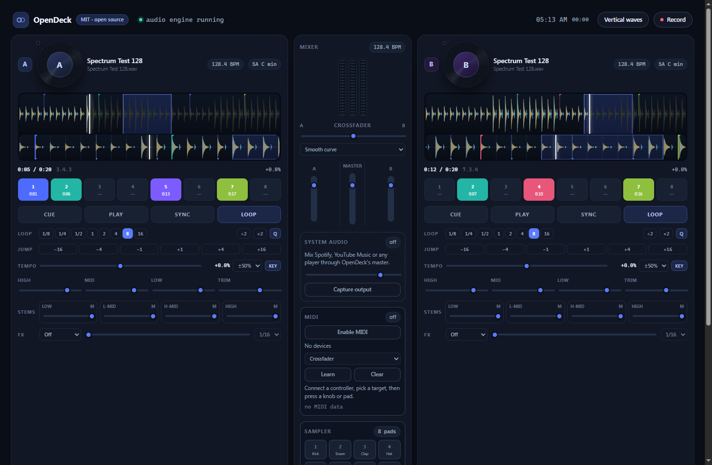
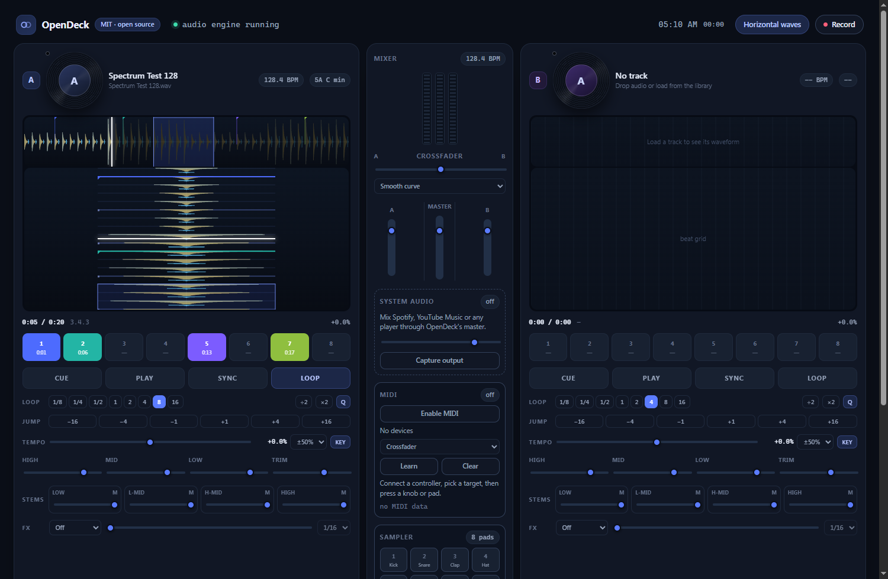

# OpenDeck (desktop)

Open-source DJ application with real DVS timecode control. TypeScript UI with an Electron shell or a Rust/Tauri shell that runs the same UI, MIT licensed. No telemetry, SeratoDJ inspired.

Windows and Linux (Flatpak manifest included).

## Screenshots





## Features

- Dark Serato-style interface with frequency-colored waveforms (bass/mid/high bands), cue flags and beat grid.
- Album artwork read from ID3v2 APIC tags (v2.2/2.3/2.4) and MP4/M4A `covr` atoms; when the file has no picture it searches the iTunes Search API using the embedded tags or the file name (a leading track number is stripped, e.g. "12 6 Man" becomes "6 Man", and results are scored against the query so a wrong song is not used). Artwork is shown on a vinyl disc for each deck, and the disc spins while that deck plays.
- Drag the vinyl disc with the mouse to scratch in real time: the deck pauses, an AudioWorklet reads the decoded track at the speed and direction of the pointer, so forward and reverse scratches are audible (pitch follows hand speed), then playback resumes from the scratched position. The worklet avoids the old seek-only behaviour.
- Two decks with SVG/canvas waveforms, overview strip and beat grid.
- Offline analysis: BPM with comb refinement, beat phase, Krumhansl key with Camelot codes, waveform peaks. WAV files are analysed by the Rust core in the Tauri build; other formats fall back to the TypeScript analyser.
- Beat sync (tempo match plus phase alignment), quantized cue/loop/jump, 8 hot cues per deck.
- Loops from 1/8 to 16 beats, halve/double, manual in/out.
- Four-band EQ (low / low-mid / high-mid / high) with mute and solo, independent from the 3-band channel EQ. These are filter bands, not source separation.
- FX chain: echo, delay, reverb, filter, flanger, phaser, bitcrush, with beat divisions and wet control.
- Crossfader with smooth, fast and cut curves; channel faders, trim, master limiter.
- Eight-pad sampler with synthesized one-shots (kick, snare, clap, hats, toms, stab), per-pad velocity, volume and Numpad 1-8 triggers.
- Web MIDI for class-compliant USB controllers, sampler pads and keyboards: connected inputs are listed with manufacturer, a live monitor shows the last message, notes 36-43 play sampler pads 1-8 by default (velocity included), and MIDI Learn covers 50 targets (crossfader, channel/master faders, deck play/cue/sync/loop, tempo, filter, hot cues and sampler pads) with mappings saved in `localStorage`. Device notes for SP-404MKII, MPK Mini, CME U6MIDI Pro and generic keyboards are in `docs/hardware.md`. The Tauri/WebView2 shell grants the MIDI permission request in the host, so Enable works without a prompt; the UI also times out with a clear message instead of hanging.
- Fullscreen performance mode: F11 toggles fullscreen, the top bar hides itself and reappears when the pointer touches the top edge, and the mixer/layout expand up to 2200px on wide screens.
- Library with search, Serato crate / database import, drag and drop, folder scan. Import MP3, WAV, FLAC, OGG/Opus, AIFF, M4A/AAC and WebM (Opus/Vorbis) audio; AAC and WebM are decoded and analysed through Web Audio, and WebM files are included in folder scans.
- Streaming tab: provider login windows, YouTube Music search inside the signed-in session, play queue. "A"/"B" buttons on each result and queue row load the track into a mini-player layered over that deck using YouTube's own embedded player. Iframe audio cannot be fed into Web Audio, so the stream is mixed with system capture (AUX): the deck faders and EQ act on the captured signal, not on the stream directly. "Open" still opens the full service page. Spotify, Apple Music, TIDAL, Beatport, Beatsource, SoundCloud and Deezer are registered as service windows; their developer-app requirements, OAuth flows, DRM constraints and current status are documented in `docs/streaming-setup.md`.
- DRM: the Tauri/WebView2 build reports Widevine and PlayReady support, so DRM services can later be embedded. Standard Electron 33 ships neither CDM, so DRM services stay in their own windows there. YouTube Music embeds do not need Widevine.
- Recording to WebM/Opus via a native save dialog.
- Broadcast: WHIP (WebRTC) out of the box; RTMP through FFmpeg, which must be installed separately and available on `PATH`. The installer does not include FFmpeg, and OpenDeck shows install guidance when it is missing.

## Documentation

- [Serato parity plan](docs/serato-parity.md): feature matrix, phases and non-goals for library and engine compatibility.
- [Library interoperability](docs/interop.md): Serato crate, database and tag formats, the rules for writing them safely, and what is implemented today.
- [Audio engine](docs/engine.md): current media-element path, the Rust PCM engine design, latency budget and test strategy.
- [Decisions](docs/decisions.md): why the engine and format work is structured this way, plus assumptions still to verify.
- [Third-party notices](NOTICE): dependency licenses and the policy on GPL and vendor assets.
- [Hardware controllers](docs/hardware.md) and [streaming setup](docs/streaming-setup.md).

## DVS

The timecode decoder is original TypeScript in `src/timecode` and `src/dvs`. It demodulates the amplitude-coded bitstream from the stereo carrier, matches it against the format's LFSR, and reports absolute position, direction and speed. Nothing is taken from Serato or Traktor except the published format parameters (carrier frequency, register length, taps, seed, record length).

Supported control media:

| Media | Carrier | Register | Absolute position |
|---|---|---|---|
| Serato CV02 side A/B | 1 kHz | 20 bit | yes |
| Serato Control CD | 1 kHz | 20 bit | yes |
| Traktor Scratch MK2 side A/B | 2 kHz | 23 bit | yes |
| MixVibes V2 / 7" | 1.3 kHz | 20 bit | yes |
| Pioneer rekordbox DVS side A/B | 1 kHz | 20 bit | yes |

How it behaves:

- Speed and pitch follow the record; the deck's playback rate is set from the decoded ratio (0.02-1.6x).
- Absolute position is used for needle drops: a jump larger than 0.35 s seeks the track.
- Lifting the needle (signal lost for 250 ms) stops the deck.
- `Set needle position` re-links the current audio position to the current groove position, so the track can start at any point.
- Stereo input is required: one turntable per stereo pair, phono preamp or a line-level control tone.

Limits:

- Reverse playback pauses the deck instead of running backwards; `HTMLAudioElement` cannot play negative rates. A reverse-capable engine is the next audio task.
- Latency is whatever the browser audio stack gives (roughly 20-40 ms). The main process asks for a 128-frame buffer, but Electron does not guarantee it across drivers.
- Timecode is mono-per-channel in the container; connect turntables to a stereo input, not a mic input.

## Rust / Tauri shell

`rust/` is a Cargo workspace with the same app behind a Tauri v2 window:

```
rust/crates/opendeck-core   DSP, WAV reader, BPM / band / chroma / key analysis (no UI deps)
rust/crates/opendeck-app    Tauri commands and window management
renderer/tauri-bridge.js    maps window.opendeckDesktop onto Tauri invoke/event
```

```
cd rust
cargo test -p opendeck-core
cargo run -p opendeck-app
```

The Tauri window embeds `renderer/` at compile time, so rebuild after changing anything in `renderer/`. Audio playback, FX, mixing, waveforms and the deck UI are the same TypeScript code as Electron. The Rust side currently provides:

- `analyze_file` / `analyze_bytes`: WAV decode plus BPM, beat phase, band peaks, chroma and key with Camelot code.
- `media_fetch`: direct URL download for the "load from URL" box.
- `recording_save`: native save dialog for recorded mixes.
- `streaming_login` / `streaming_open`: opens the provider in a separate persistent WebView2 window.
- `streaming_status` / `streaming_search`: reads the shared WebView2 cookie store for login detection, and searches YouTube Music through its signed-in InnerTube API (SAPISIDHASH).
- `rtmp_available` / `rtmp_start` / `rtmp_chunk` / `rtmp_stop`: pipe the recorded stream into `ffmpeg` from `PATH` (or `OPENDECK_FFMPEG` when set).

Not ported yet: DVS input and system-audio loopback capture.

## Streaming and broadcast limits

- In Electron, providers are opened in their own windows under persistent sessions (`persist:provider-<id>`). Login detection uses cookie hints; credentials never touch OpenDeck.
- Search and queueing use the signed-in session. Playback happens in the provider player and is mixed through the Windows loopback capture (`setDisplayMediaRequestHandler` with `audio: "loopback"`), so nothing is downloaded or decrypted. DRM is not bypassed.
- YouTube Music search parses `ytInitialData`; markup changes can break it.
- WHIP needs a WebRTC endpoint. RTMP needs FFmpeg installed and on `PATH`; it is not bundled with the installer. Download it from <https://ffmpeg.org/download.html>, add its `bin` directory to `PATH`, and restart OpenDeck. Windows builds are also available from <https://www.gyan.dev/ffmpeg/builds/> or <https://github.com/BtbN/FFmpeg-Builds/releases>.

## Run

```
npm install
npm start
```

`npm start` builds the Electron bundles and opens the app. FFmpeg is not bundled; install it and add it to `PATH` before using RTMP.

```
npm test        # engine, streaming, timecode and DVS transport tests (node:test)
npm run build   # dist/main.cjs, dist/preload.cjs, renderer/app.js, renderer/dvs.js
```

Tests generate timecode signals for every supported media, add noise and gain changes, run them through the real decoder in 480-sample blocks, and check lock, speed, absolute position, needle drops, stalls and reverse. Engine tests cover FFT, BPM/key analysis, beat grids, sync, FX maths, stem gains and the play queue.

## Verification status

Verified on Windows with Electron 33:

- `npm test`: 68/68 pass.
- `npx tsc --noEmit`: clean.
- UI smoke test over CDP: two decks, 16 pads, 6 providers, 3 tabs, DVS bar, no console errors.
- Synthetic 128 BPM WAV loaded through the real pipeline: analysis 127.7 BPM / A# min, audible output at the analyser, loop snapped to beats, hot cue stored, echo FX active, sync between decks.

Verified on Windows with the Tauri v2 shell (WebView2 155, Rust 1.99):

- `cargo test -p opendeck-core`: 7/7 pass (BPM accuracy, band split, peaks, chroma, key).
- `cargo build -p opendeck-app`: clean.
- CDP smoke test: `window.__opendeckRuntime === "tauri"`, UI renders two decks and 16 pads.
- `analyze_file` on the 128 BPM demo: BPM 128.42, duration 20 s, 2000 peaks, 2000 points per band, key/Camelot returned.
- `media_fetch` against a local HTTP server returned a real `Uint8Array` (audio/wav, 1,764,044 bytes).
- `streaming_search` returned HTTP 200 and the page body.
- `rtmp_available` returned false without FFmpeg on `PATH`, and the broadcast panel showed the install guidance instead of enabling RTMP.
- Loading a WAV through the real UI pipeline used the Rust result (128.42 BPM in the library and deck header), rendered the band waveform and enabled the deck.
- ID3v2 artwork: a generated APIC tag embedded in a test file was read into a blob URL, applied to both deck vinyls, and the spin animation reported `running` while playing and `paused` when stopped. The parser has 7 unit tests (v2.3, v2.4, front-cover preference, no tag, text frames, query building, iTunes response).
- Artwork web fallback: a WAV named "Daft Punk - One More Time.wav" with no ID3 tag was searched on iTunes, the cover downloaded and decoded (`naturalWidth > 0`), and applied to the vinyl when loaded.
- M4A artwork: a real `12 6 Man.m4a` (Drake) parsed as title "6 Man", artist "Drake", album "If You're Reading This It's Too Late" and a 101,820-byte JPEG from its `covr` atom, so no iTunes lookup is needed. Track-number stripping and result scoring have unit tests.
- Vinyl scratch: synthetic pointer drag of 308 degrees over deck A moved playback from 0 s to 1.54 s (1.8 s per turn) and produced audible output from the AudioWorklet path (analyser RMS 0.43 forward, 0.49 reverse, 0 when the hand stopped). The disc class cleared on release and the deck stayed paused because it was not playing before the gesture.
- Drag and drop simulation in the Tauri window: `dragenter` set the drop-zone highlight, dropping files on the drop zone added a library row, and dropping on deck A added the track to the library and loaded it into the deck.
- Tauri file drops required `dragDropEnabled: false`; OS-level dragging from Explorer was not automated, so retest that by hand.
- Google sign-in window loads after the provider commands became `async` (sync commands deadlock WebView2 window creation on Windows).
- `streaming_status` read the real WebView2 cookie store after signing into YouTube Music in-app and returned `SAPISID`, `__Secure-3PSID` and `SID` as matched, so the UI shows "signed in".
- YouTube Music search used the signed-in InnerTube API (`youtubei/v1/search`, `SAPISIDHASH`); the UI listed 17 results for "daft punk" with queue buttons. Artist names are missing for some rows because the API response omits them.
- Deck mini-player: `playStreamOnDeck` created a 302x170 `youtube-nocookie.com` embed over deck A for "Never Gonna Give You Up", set the deck title and AUX warning, and the embed started playing (progress reached 0:13). Closing it removed the iframe.
- EME probe in WebView2 155: `com.widevine.alpha` and `com.microsoft.playready` are supported. The same probe in Electron 33.4.11: both unsupported (no CDM), which is why in-app DRM playback is Tauri-only.
- Web MIDI in the Tauri build: `navigator.requestMIDIAccess()` resolved (`0 inputs, 0 outputs` with no hardware attached) and the Enable button switched the card to "no device" instead of hanging. The input list, live monitor and default drum-note mapping (36-43 to the eight sampler pads) are covered by unit tests; physical SP-404MKII, MPK Mini and CME U6MIDI Pro hardware still needs a hands-on test.
- Sampler: all eight pads rendered, Numpad triggers flashed and the master peak meter registered the output (about 10 dB).
- Fullscreen at 1920x1080: the app expanded to 1905px, the top bar slid out (`translateY(-60.5px)`, opacity 0), hovered back in at the top edge and hid again after the pointer left.

Not verified on this machine:

- Live DVS input (no audio interface available).
- SDK playback for Spotify, Apple Music and SoundCloud (needs credentials: Spotify Premium + client ID, Apple MusicKit developer token, SoundCloud client ID). TIDAL, Beatport and Beatsource have no public playback SDK, so they remain service windows; see `docs/streaming-setup.md`.
- RTMP broadcast to a live ingest server (no server or stream key available), and RTMP with FFmpeg installed. The installer intentionally excludes FFmpeg.
- Native save dialog in the Tauri build (cannot be scripted headlessly).
- System-audio loopback capture and DVS in the Tauri build, and therefore mixing the deck mini-player through AUX.
- Flatpak build (no `flatpak-builder`).

## Flatpak

`packaging/` holds the manifest (`io.opendeck.OpenDeck.yml`), launcher, desktop entry and metainfo. Building needs `flatpak-builder` and the `org.electronjs.Electron2.BaseApp` runtime:

```
flatpak install flathub org.freedesktop.Platform//24.08 org.freedesktop.Sdk//24.08 org.electronjs.Electron2.BaseApp//24.08
flatpak-builder --user --install --force-clean build packaging/io.opendeck.OpenDeck.yml
```

The bundle expects `dist/`, `renderer/` and `node_modules/` in the source tree, so run `npm run build` first.

## Layout

```
src/renderer/app.ts          UI wiring, analysis queue, sync, recording, streaming, broadcast
src/renderer/engine/         deck, mixer, sync, beat grids, FX, stems, FFT, analysis
src/renderer/media/          library, Serato crate parser, waveform renderers
src/renderer/streaming/      providers, queue, YouTube Music search parsing
src/renderer/broadcast/      WHIP/WebRTC broadcaster
src/renderer/dvs-panel.ts    input capture and deck coupling
src/timecode/                timecode format params, LFSR, decoder, encoder
src/dvs/                     deck-level DVS transport and simulator
src/main/main.ts             Electron window, sessions, media fetch, loopback, RTMP, save dialog
src/preload/preload.ts       window.opendeckDesktop bridge
rust/crates/opendeck-core/   Rust DSP, WAV reader and analysis
rust/crates/opendeck-app/    Tauri commands, streaming windows, RTMP bridge
renderer/                    HTML, CSS, built scripts, tauri-bridge.js
test/                        node:test suites
packaging/                   Flatpak manifest and desktop files
```

## Legal

OpenDeck is licensed under the MIT License. It is an independent project and is
not affiliated with, sponsored by or endorsed by Serato, AlphaTheta (Rekordbox),
Native Instruments (Traktor) or any other DJ vendor. Product names are used only
to describe file-format and hardware compatibility. No vendor source code,
assets, fonts, audio, manual text or visual design is included. Serato and
Rekordbox are trademarks of their respective owners.

FFmpeg is not bundled or redistributed; install it separately under its own
license. Third-party dependencies and their licenses are listed in
[NOTICE](NOTICE).


